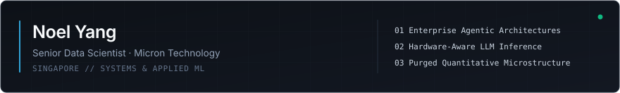

<picture>
  <source media="(prefers-color-scheme: dark)" srcset="assets/header-dark.svg" />
  <source media="(prefers-color-scheme: light)" srcset="assets/header-light.svg" />
  
</picture>

 

I design and ship production multi-agent systems, hardware-aware LLM inference pipelines, and zero-lookahead quantitative trading architectures. Currently a Senior Data Scientist at **Micron Technology** in Singapore.

### Selected Research &amp; Systems

- **[Purged Walk-Forward Ensembles &amp; Cross-Market Regime Governance](https://noeltw.github.io/quant-research/)** — *Working Paper 2026-11.* Dual-engine systematic alpha combining Kyle's $\lambda$ volume-normalized institutional flow, double-neutralized multi-task GBDTs, and US volatility gearboxes (`Rank-Norm PSI = 0.0020` in live production).
- **[Enterprise Multi-Agent Orchestration (`adk-agentic-ai`)](https://github.com/NoelTW/adk-agentic-ai)** — Deterministic tool-calling workflows, subagent synthesis, and structured execution graphs built on Google ADK.
- **[Portfolio &amp; Retirement Cash-Vault Stress Simulator](https://noeltw.github.io/fire-investment/)** — Interactive historical drawdown and sequence-of-returns stress-testing engine with live multi-currency FX modeling.
- **[Transformer From First Principles (`neetcode-gpt`)](https://github.com/NoelTW/neetcode-gpt)** — Clean PyTorch implementation of BPE tokenization, Grouped-Query Attention (GQA), RMSNorm, and KV-cached autoregressive decoding.

### Ongoing Explorations

- **Deterministic Agent Chaos Engineering** — Cassette-based tool replay and fault-injection harnesses (schema drift, indirect prompt injection, and failure-induced hallucination gates) for MCP / tool-use agents.
- **Frontier LLM Attribution &amp; Constrained Inference** — Cross-tokenizer representation ensembles, layer-streamed log-likelihood curvature, and Sinkhorn-slack Partial Optimal Transport under tight GPU memory budgets.

---

Singapore &nbsp;&middot;&nbsp; <a href="mailto:noelyang0208@gmail.com">noelyang0208@gmail.com</a> &nbsp;&middot;&nbsp; <a href="https://noeltw.github.io/quant-research/">Quantitative Whitepaper</a>
