<!-- Hero: macOS Terminal System Readout -->

  

# Noel Yang
### Senior Data Scientist @ Micron Technology · Agentic AI & Autonomous Systems

> Singapore 🇸🇬 &nbsp;·&nbsp; Primary: Enterprise Agentic AI &amp; Frontier LLMs &nbsp;·&nbsp; Side Research: Purged Quantitative Systems &amp; Competitive ML

---

## 🏛️ Systems & Engineering Architecture

### 01. Enterprise Agentic AI & Industrial LLMs *(Primary Focus · Micron Technology)*
Architecting autonomous reasoning systems and multi-agent workflows for complex semiconductor & industrial intelligence challenges:
* **Multi-Agent Orchestration**: Stateful multi-agent execution graphs, dynamic subagent delegation, and deterministic tool-use routing.
* **Enterprise Context & Memory**: Scalable Retrieval-Augmented Generation (RAG) with hybrid dense/sparse vector search and cross-encoder reranking over technical corpora.
* **Production Guardrails & Evaluation**: Automated LLM-as-a-Judge harnesses, AST-enforced anti-leakage checks, and GPU latency/VRAM budget optimization.

### 02. Dual-Engine Quantitative Trading System *(Side Alpha · Purged Walk-Forward Verified)*
A decoupled, zero-lookahead systematic trading and MLOps risk-governance engine exploiting tax and microstructure asymmetry across Taiwan equities and US leveraged ETFs:
* **`Titan-4S (TW Mid-Cap Value-Growth)`**: Double-neutralized (28 sectors + log-cap) multi-task GBDT + Left-Tail Crash Head + **Kyle's Lambda** volume-normalized institutional impact ($\overline{Q}_{3d}/\overline{V}_{20d}$) across liquid mid-caps (`ADV >= NT$30M`, 3-week rebalance) — *Audited Full CAGR **+53.08%** (`2024–2026` Post-Freeze OOS **+68.77%**) · Daily Sharpe **2.34** · MDD **-12.13%** · 2022 Bear **+5.23%***.
* **`TQQQ-007 M14-Apex (US Macro Gearbox)`**: Asymmetric 180-SMA hysteresis (`+1.0% / -0.5%`), 4-speed realized volatility gearbox, and 3D credit/duration/FX shield (`HYG/IEF`, `IEF/TLT`, `FXY` carry-unwind, `CBOE VIX/VIX3M` 4D crash radar) with `SGOV` T-Bill shelter — *10-Year Audited CAGR **+55.10%** · MDD **-29.88%** (vs. -81.65% Buy & Hold) · Calmar **1.84***.
* **Production MLOps**: Twice-daily stateless GitHub Actions pipelines, live Population Stability Index serving-skew telemetry (`Rank-Norm PSI = 0.0020`), and sub-account isolated broker execution.
* 📄 **Research Publication**: [**Read the Post-Audit Quantitative Whitepaper (2026-11) ↗**](https://noeltw.github.io/quant-research/) *(Published on GitHub Pages)*

### 03. Competitive ML & Frontier LLM Attribution *(Ongoing Research)*
First-principles experimental systems for fine-grained model attribution, representation learning, and constrained inference under strict compute budgets:
* **Cross-Architecture Neural Ensembles**: Multi-tokenizer LoRA representation fusion across dense, hybrid linear-attention (Gated-DeltaNet), embedding, and cross-encoder backbones.
* **Segmented Likelihood & Optimal Transport**: Layer-streamed C++/CUDA log-likelihood curvature extraction paired with Sinkhorn-slack Partial Optimal Transport under strict Nested K-Fold & AST anti-overfitting gates.

---

## ⚙️ Technical Matrix

| Domain | Core Technologies & Methodologies |
| :--- | :--- |
| **Agentic AI & Frontier LLMs** | Multi-Agent Orchestration, Tool-Use & Function Calling, LoRA / Representation Fine-Tuning, Segmented GGUF / CUDA Inference, RAG |
| **Machine Learning & Optimization** | PyTorch, Transformers, GBDT Ensembles (LightGBM, CatBoost, XGBoost), Optimal Transport, Purged Walk-Forward & Nested CV |
| **Data Engineering & MLOps** | Python (`uv`), FastAPI, C++, Docker, Linux / Zsh, PSI Drift Telemetry, GitHub Actions Serverless CI/CD |
| **Quantitative Finance** | Market Microstructure (Kyle's Lambda), Double Neutralization, Volatility Targeting, Cross-Asset Credit/FX Regime Circuit Breakers |

---

## 📊 Telemetry & Activity

<!-- Dynamic Contribution Snake Animation -->

  

  <table border="0" cellspacing="0" cellpadding="0">
    <tr>
      <td align="center" valign="middle">
        
      </td>
      <td align="center" valign="middle">
        
      </td>
    </tr>
  </table>
   
  

---

## 📬 Contact & Connect

  
  &nbsp;&nbsp;
  

